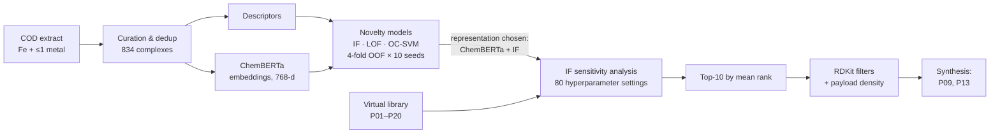

<div align="center">

# FELINA

**Fe Ligand–metal Isolation-forest Novelty Assessment: machine learning-guided prioritization of iron coordination compounds as micronutrient fertilizers**

[](https://www.python.org/)
[](https://scikit-learn.org/)
[](https://huggingface.co/DeepChem/ChemBERTa-100M-MLM)
[](LICENSE)
[](data/LICENSE)

Code and data accompanying the manuscript<br>
*Machine Learning-Guided Discovery of Iron Fertilizer Complexes: From Virtual Screening to Agronomic Validation in Light-Cultured* Diplotaxis tenuifolia

Center for Artificial Intelligence in Chemistry, ITMO University

</div>

---

## Overview

Commercial iron fertilizers are almost exclusively mononuclear chelates (Fe-EDTA, Fe-DTPA, Fe-EDDHA). This repository contains the computational part of a study evaluating **iron coordination compounds, including heterobimetallic ones,** as an alternative iron-delivery motif.

Because crystallographic databases record compounds that *were* made, but not those that failed, the task is framed as **one-class novelty detection**: candidates are ranked by how closely they resemble the distribution of experimentally characterized bimetallic Fe complexes from the [Crystallography Open Database](https://www.crystallography.net/cod/).

- **Reference set:** 834 bimetallic Fe complexes from COD, 8 metal-pair groups
- **Representations:** composition/physicochemical descriptors vs. 768-d ChemBERTa embeddings
- **Novelty models:** Isolation Forest, Local Outlier Factor, One-Class SVM; out-of-fold scoring, 10 random seeds
- **Screening:** 20-member laboratory-accessible virtual library ranked with Isolation Forest over 80 hyperparameter settings (sensitivity analysis)
- **Filtering:** RDKit substructure/elemental filters and active-payload mass fraction

Two prioritized candidates, **P09** (NEt₄)[Fe(H₂O)₂(Mal)₂] and **P13** {(NH₄)[BaFe(H₂O)₅(Mal)₃]·H₂O}ₙ, were synthesized and tested on *Diplotaxis tenuifolia* (experimental details are in the manuscript).

## Workflow



## Repository structure

```
.
├── data/
│   ├── data_train.csv                # curated COD reference set (834 × descriptors + ChemBERTa embeddings)
│   ├── chemberta_embeddings.parquet  # ChemBERTa embeddings keyed by cod_id
│   ├── virtual_library.csv           # 20 candidate complexes (P01–P20)
│   ├── top_10.csv                    # top-10 shortlist by mean rank
│   └── README.md                     # data dictionary
├── notebooks/
│   ├── 01_representation_benchmark.ipynb  # representation × algorithm comparison, seed robustness
│   ├── 02_ensemble_screening.ipynb        # library embedding + ranking over 80 hyperparameter settings
│   └── 03_candidate_filtering.ipynb       # RDKit filters and active-payload density
├── results/
│   └── screening_run/                # aggregate ranking, run metadata, environment log
├── requirements.txt
├── CITATION.cff
└── LICENSE
```

## Installation

```bash
git clone https://github.com/KurbanovDavid777/FELINA.git
cd FELINA
python -m venv .venv && source .venv/bin/activate
pip install -r requirements.txt
```

The original screening run used Python 3.12, PyTorch 2.11 (CPU), scikit-learn 1.6.1, transformers 5.13.1 (see [`results/screening_run/environment_log.txt`](results/screening_run/environment_log.txt)).

## Usage

Run the notebooks from the `notebooks/` directory in order:

```bash
cd notebooks
jupyter lab
```

| Notebook | What it does | Main outputs |
|---|---|---|
| `01_representation_benchmark` | Out-of-fold novelty scoring of the reference set (4-fold, stratified by metal pair) with three algorithms on descriptor, embedding and combined representations; Spearman correlation and top-k overlap across 10 seeds | `results/representation_benchmark/`, `results/models/` |
| `02_ensemble_screening` | Embeds the library with ChemBERTa (pinned revision), ranks it with 80 Isolation Forest configurations, aggregates ranks | `results/screening_run/summary_*.csv` |
| `03_candidate_filtering` | Applies Co/Cu, fumarate, succinate and counterion filters to the top-10; computes Fe/Zn/Mn mass fraction | printed table |

## Results

Aggregate ranking of the virtual library across 80 Isolation Forest hyperparameter settings ([`results/screening_run/summary_20260809_180516.csv`](results/screening_run/summary_20260809_180516.csv)). Lower mean rank = closer to known bimetallic Fe chemistry. **Bold** — synthesized compounds.

| # | ID | Formula | Ligand | 2nd metal | Mean rank ± SD | Top-10, % | Shortlist |
|---|---|---|---|---|---|---|---|
| 1 | P07 | `C14H20FeMnNO12` | oxalate | Mn(II) | 5.06 ± 3.77 | 87.5 | ✓ |
| 2 | P19 | `C12H24CuFe2O16` | acetate | Cu(II) | 5.40 ± 4.72 | 76.2 | ✓ |
| 3 | P17 | `C2H14CoFeO10P2` | phosphonate | Co(II) | 6.29 ± 4.49 | 80.0 | ✓ |
| 4 | P10 | `C4H12FeN2O10` | oxalate | — | 6.31 ± 4.75 | 80.0 | ✓ |
| 5 | P15 | `C3H13FeNO9P3Zn` | phosphonate | Zn(II) | 6.75 ± 3.57 | 83.8 | ✓ |
| 6 | **P13** | `C9H22BaFeNO18` | malonate | Ba(II) | 7.00 ± 3.16 | 86.2 | ✓ |
| 7 | P02 | `C8H12FeO12Zn` | fumarate | Zn(II) | 7.22 ± 5.32 | 73.8 | ✓ |
| 8 | **P09** | `C14H28FeNO10` | malonate | — | 8.59 ± 4.46 | 67.5 | ✓ |
| 9 | P04 | `C12H24BaFeNO16` | succinate | Ba(II) | 8.66 ± 4.11 | 66.2 | ✓ |
| 10 | P20 | `C8H12FeMnNO14` | malonate/oxalate | Mn(II) | 9.53 ± 4.01 | 57.5 | ✓ |
| 11 | P05 | `C17H34BaFeNO16` | malonate | Ba(II) | 10.38 ± 5.32 | 57.5 |  |
| 12 | P18 | `C12H22BaFeNO18` | citrate | Ba(II) | 11.54 ± 4.13 | 50.0 |  |
| 13 | P03 | `C6H12BaFeNO16` | oxalate | Ba(II) | 11.76 ± 3.09 | 31.2 |  |
| 14 | P06 | `C6H4CuFeNO12` | oxalate | Cu(II) | 12.68 ± 3.05 | 23.8 |  |
| 15 | P08 | `C6H4CoFeNO12` | oxalate | Co(II) | 13.04 ± 4.63 | 20.0 |  |
| 16 | P14 | `C8H16CoFeO12` | succinate | Co(II) | 13.14 ± 5.18 | 31.2 |  |
| 17 | P12 | `C12H18FeMnNO16` | fumarate | Mn(II) | 13.28 ± 3.04 | 13.8 |  |
| 18 | P11 | `C6H8CuFeO10` | malonate | Cu(II) | 14.62 ± 5.09 | 13.8 |  |
| 19 | P16 | `C26H37FeNO9P3` | phosphonate | — | 18.84 ± 0.92 | 0.0 |  |
| 20 | P01 | `C6H18FeN3O15` | oxalate | — | 19.71 ± 0.62 | 0.0 |  |

## Scope and limitations

The novelty score estimates **structural plausibility relative to known bimetallic Fe chemistry**. It is not a predictor of reaction feasibility, stability, solubility or agronomic efficacy, and was used only as a prioritization filter over a laboratory-accessible shortlist. Component SMILES do not encode metal–ligand connectivity or coordination geometry. See the Conclusion of the manuscript for a full discussion.

## Data sources

Reference structures are derived from the Crystallography Open Database (accessed April 2026), whose data are in the public domain. Please also cite COD:

- Gražulis, S. et al. Crystallography Open Database, an Open-Access Collection of Crystal Structures. *J. Appl. Crystallogr.* **2009**, 42, 726–729. [doi:10.1107/S0021889809016690](https://doi.org/10.1107/S0021889809016690)
- Gražulis, S. et al. Crystallography Open Database (COD): an Open-Access Collection of Crystal Structures and Platform for World-Wide Collaboration. *Nucleic Acids Res.* **2012**, 40, D420–D427. [doi:10.1093/nar/gkr900](https://doi.org/10.1093/nar/gkr900)

Embeddings: Chithrananda, S.; Grand, G.; Ramsundar, B. ChemBERTa: Large-Scale Self-Supervised Pretraining for Molecular Property Prediction. [arXiv:2010.09885](https://arxiv.org/abs/2010.09885) (2020).

## Citation

If you use this code or data, please cite the manuscript (citation will be updated upon publication) — see [`CITATION.cff`](CITATION.cff).

## License

- Code: [MIT](LICENSE)
- Data in `data/` and `results/`: [CC BY 4.0](data/LICENSE)

## Contact

David Kurbanov — Center for Artificial Intelligence in Chemistry, ITMO University<br>
Corresponding author of the manuscript: Nikita Vasilev
